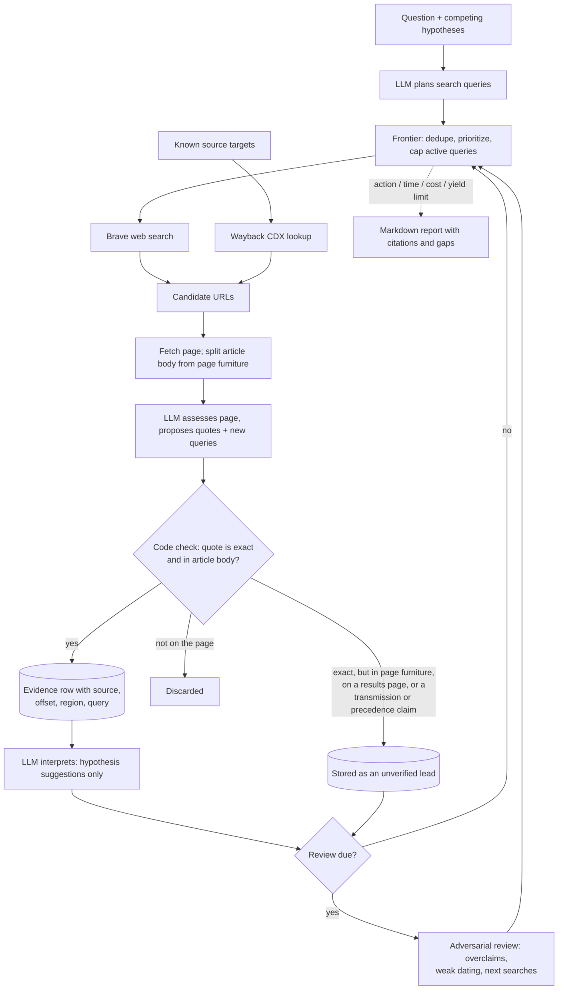

<p align="center">
  <picture>
    <source media="(prefers-color-scheme: dark)" srcset="docs/assets/hypertrace-mark-dark.svg">
    
  </picture>
</p>

[](https://github.com/junglestyle/hypertrace/actions/workflows/test.yml)

# Hypertrace

A research harness where an LLM proposes searches and reads sources, but code decides what counts as evidence.

Hypertrace runs bounded web research on historical questions, such as where a term first appeared. The model plans searches, reads fetched pages, and suggests interpretations. Every source, exact quote, and model call is stored in SQLite, so any claim in the final report can be traced back to the page text it came from. It is built for questions where a fluent but wrong answer is worse than "inconclusive".

## What a run concludes

The repo ships with one question: did the genre term "hyperpop" descend from Björk's 1995 song "Hyperballad", or are they independent uses of "hyper-"? After 25 runs, 555 page captures and 104 evidence rows, the report opens like this:

```text
## Current conclusion

Inconclusive. No demonstrated transmission is recorded. Observed usage, chronology, and similarity alone do not establish origin or influence.
Latest run: stopped (max_actions); 500 logical actions, 87 provider requests, provider-reported cost $0.5624, locally estimated cost $0.0000, 0 requests with provider billing unknown.
Run 25: 500 actions; 323 productive research actions; evidence +30; target transitions 0.
Failures: search none; retrieval client 28, connection 35, other 5, server 3, throttle 20, timeout 13; provider 6 failures, 6 retries, 0 failovers.
Queries: added 131, deferred 87, exhausted 2, rejected 3; reviews 15 (triggers: action_threshold 14, important_evidence 1).
Cost: research $0.0843 reported / $0.1081 local; review $0.4782 reported / $0.2673 local; billing unknown 0 requests.
```

On this record, "Inconclusive" is the right reading, and code writes it, not the model. The report says anything else only when an evidence row from a verified primary source records demonstrated transmission, and no automated step can mark one.

The lines under it say why the run stopped, what failed, and what it cost, split into the research and review models and into provider-reported and locally estimated cost. All 25 runs together made 564 provider requests: $2.98 in provider-reported cost, $0.09 estimated locally where a provider reported no usage, and 80 requests whose billing stays unknown.

The rest of the report is in [docs/sample-report.md](docs/sample-report.md), trimmed.

## One claim, traced

Evidence E58 is a sentence from Pitchfork's guide to PC Music, on a page dated 2014, calling the label's sound "hyper-pop". In the report:

```text
- E58 [G101; observed_usage; unknown; article_body]: “The shadowy operation and its bewildering brand of hyper-pop have been everywhere in the past few months, from UK broadcasters like Rinse FM to the XL Records roster to Boiler Room broadcasts, and its influence seems to be growing on a daily basis.” [PC Music's Twisted Electronic Pop: A User's Manual \| Pitchfork](https://pitchfork.com/thepitch/485-pc-musics-twisted-electronic-pop-a-users-manual/). Page publication metadata: 2014-09-17 (unverified for this quote). Context: …
```

Its provenance note, at the end of the report, names the stored page and the offset:

```text
- E58 → source 268, retrieved 2026-09-24T12:32:33.749674+00:00, quote offset 441, text SHA-256 `541f1eb36f85eb1bb2b7199077664f9ca81ec87169a21cdb08e2aac258423a56`, … verified target pc-music-2014; … Quote date remains unverified.; …
```

And the page text is in the database, at that offset, inside a span the extractor labelled article body (SQLite's `substr` counts from 1):

```console
$ sqlite3 hypertrace.db "SELECT substr(content, 442, 61) FROM sources WHERE id=268"
The shadowy operation and its bewildering brand of hyper-pop
$ sqlite3 hypertrace.db "SELECT r.value->>'region', r.value->>'start', r.value->>'end'
    FROM sources s, json_each(s.regions_json) r
    WHERE s.id=268 AND r.value->>'start' <= 441 AND 441 < r.value->>'end'"
article_body|355|689
```

The model proposed that quote. Code accepted it only after finding it verbatim in the article body. It still isn't in the report's verified chronology: the page says September 17, 2014, but page metadata never dates a quote. The adversarial review names what would settle it: if 2014 Wayback captures of the article lack "hyper-pop", the sentence is a later edit.

## One quote refused

On The Independent's interview with 100 gecs, the model proposed this sentence as evidence:

> With their 2019 debut, Laura Les and Dylan Brady gave the world ‘hyperpop’.

The sentence is on the page word for word, but it's the standfirst in the page header, which the extractor labelled navigation. Code kept it as a lead instead:

```console
$ sqlite3 hypertrace.db "SELECT value, rationale FROM leads WHERE id=145"
With their 2019 debut, Laura Les and Dylan Brady gave the world ‘hyperpop’.|Unverified navigation excerpt; not accepted as dated usage or transmission evidence.
```

A lead is something to check. The report lists it, but never cites it as evidence.

## How a run works



- **Code enforces provenance.** A model-proposed quote becomes evidence only if it appears verbatim in the fetched article body. Quotes from navigation, sidebars, or search snippets are kept as leads instead. Page publication dates never date a quote. Model interpretations are stored as suggestions and never change a hypothesis's status.
- **Adversarial review on a schedule.** A separate review model challenges the stored record: overclaims, weak dating, repeated secondary claims. It can retire exhausted search avenues and add up to 3 high-value queries. Review runs after 25 meaningful actions, or earlier when important new evidence arrives. A failed review stops the run and stays due for the next run.
- **Cost accounting per provider attempt.** Every HTTP attempt is logged with provider, role, retry reason, and token usage. Cost is split into provider-reported, locally estimated, and unknown. Before each call, the worst-case cost (all retries, a schema-repair call, and fallback) is reserved against `--max-cost`.
- **Rate-limit failover for review.** After two HTTP 429s from the primary review provider, the call moves to a configured fallback provider. `Retry-After` headers are honored. Diagnostics are stored without prompts, response text, or API keys.
- **Resumable, crash-safe state.** Multi-record state changes are written in single SQLite transactions. A file lock allows one run per question. Failed fetches and searches are kept with retry times, so the next run picks up where the last one stopped.

## A run, end to end

Install, check, and configure a Brave Search key and any OpenAI-compatible chat API ([docs/install.md](docs/install.md) has every setting):

```sh
uv sync --extra dev
uv run pytest                      # 149 tests, no API keys or network needed
export BRAVE_SEARCH_API_KEY=... LLM_BASE_URL=... LLM_API_KEY=... RESEARCH_MODEL=...
```

Ask a question with competing hypotheses. `uv run hypertrace init` seeds this one; `research` adds any question:

```console
$ uv run hypertrace research "Did the modern musical genre term \"hyperpop\" have any genealogical relationship to Björk's 1995 song \"Hyperballad\", or are these independent uses of \"hyper-\"?" \
    --hypothesis "Modern hyperpop terminology drew on Björk's Hyperballad." \
    --hypothesis "Modern hyperpop terminology arose independently from the productive hyper- prefix." \
    --hypothesis "Several distinct hyperpop coinages or uses converged in later genre discourse."
Created question 1
```

Run it with limits. A run stops at the first one it reaches: actions, minutes, `--max-cost` in USD, or `--min-yield`:

```sh
uv run hypertrace run --max-actions 500 --max-minutes 60
```

Run 25 of the sample stopped at its action limit after 57 minutes and printed:

```text
Run 25: stopped (max_actions), 500 logical actions, 87 provider requests, provider-reported cost $0.5624, locally estimated cost $0.0000, 0 requests with provider billing unknown
```

`status` shows where the question stands, including the next review and the last run's failures and cost:

```console
$ uv run hypertrace status
Question 1 [active]: Did the modern musical genre term "hyperpop" have any genealogical relationship to Björk's 1995 song "Hyperballad", or are these independent uses of "hyper-"?
5 hypotheses; 104 evidence; 12 active queries; 465 deferred leads; 136 exhausted queries; 323 rejected duplicates; 1 pending pages
Review cadence: 17/25 meaningful actions since last review; important evidence []; target changes []; hypothesis changes []; last decision skipped (no_material_change)
Last run 25: stopped (max_actions); 87 provider requests; provider-reported cost $0.5624; locally estimated cost $0.0000; 0 with provider billing unknown
Run 25: 500 actions; 323 productive research actions; evidence +30; target transitions 0.
Failures: search none; retrieval client 28, connection 35, other 5, server 3, throttle 20, timeout 13; provider 6 failures, 6 retries, 0 failovers.
Queries: added 131, deferred 87, exhausted 2, rejected 3; reviews 15 (triggers: action_threshold 14, important_evidence 1).
Cost: research $0.0843 reported / $0.1081 local; review $0.4782 reported / $0.2673 local; billing unknown 0 requests.
```

`evidence` lists every accepted quote with its type and source (3 of 104 shown):

```console
$ uv run hypertrace evidence
…
E58 [observed_usage] The shadowy operation and its bewildering brand of hyper-pop have been everywhere in the past few months, from UK broadcasters like Rinse FM to the XL Records roster to Boiler Room broadcasts, and its influence seems to be growing on a daily basis.
  https://pitchfork.com/thepitch/485-pc-musics-twisted-electronic-pop-a-users-manual/
…
E31 [attributed_usage] Over email, McDonald said he first saw the term applied to PC Music’s releases in 2014 but it wasn’t until 2018 that hyperpop qualified as a microgenre: “For our categorization purposes it was mostly a matter of waiting to see if enough artists would coalesce around a similar ebullient electro-maximalism.”
  https://web.archive.org/web/20210414144546/https:/www.nytimes.com/2020/11/10/arts/music/hyperpop-spotify.html
…
E96 [attributed_origin_claim] Then in 2019, when Spotify coined the phrase and launched an official curated playlist, the glitchy, metallic sounds of hyperpop soon found Gen Z audiences worldwide on social media platforms like TikTok
  https://musictech.com/guides/essential-guide/best-hyperpop-songs/
…
```

`hypotheses` shows each one's status. Runs never change a status: the model can propose new hypotheses (H5 and H8 here) and suggest statuses, but its suggestions appear in the report marked "not accepted".

```console
$ uv run hypertrace hypotheses
H1 [open] Modern hyperpop terminology drew on Björk's Hyperballad.
  Competing starting hypothesis; untested.
H2 [open] Modern hyperpop terminology arose independently from the productive hyper- prefix.
  Competing starting hypothesis; untested.
H3 [open] Several distinct hyperpop coinages or uses converged in later genre discourse.
  Competing starting hypothesis; untested.
H5 [open] The 2019 Spotify 'hyperpop' playlist name may have been a rediscovery/reuse of earlier critic terminology (1988, 2014) rather than an independent coinage.
  Proposed during interpretation.
H8 [open] The 1988 Shewey 'hyperpop' usage and the 2010s genre term are semantically unrelated senses of the same productive 'hyper-' + pop construction.
  Proposed during interpretation.
```

`report` writes the Markdown report, like the [sample](docs/sample-report.md):

```console
$ uv run hypertrace report --output report.md
report.md
```

## Stack

Python 3.13, SQLite, httpx, Pydantic, any OpenAI-compatible chat API, Brave Search API, Internet Archive CDX; pytest and uv.

## Status

Working prototype, run from the command line. The repo ships with one example question.
